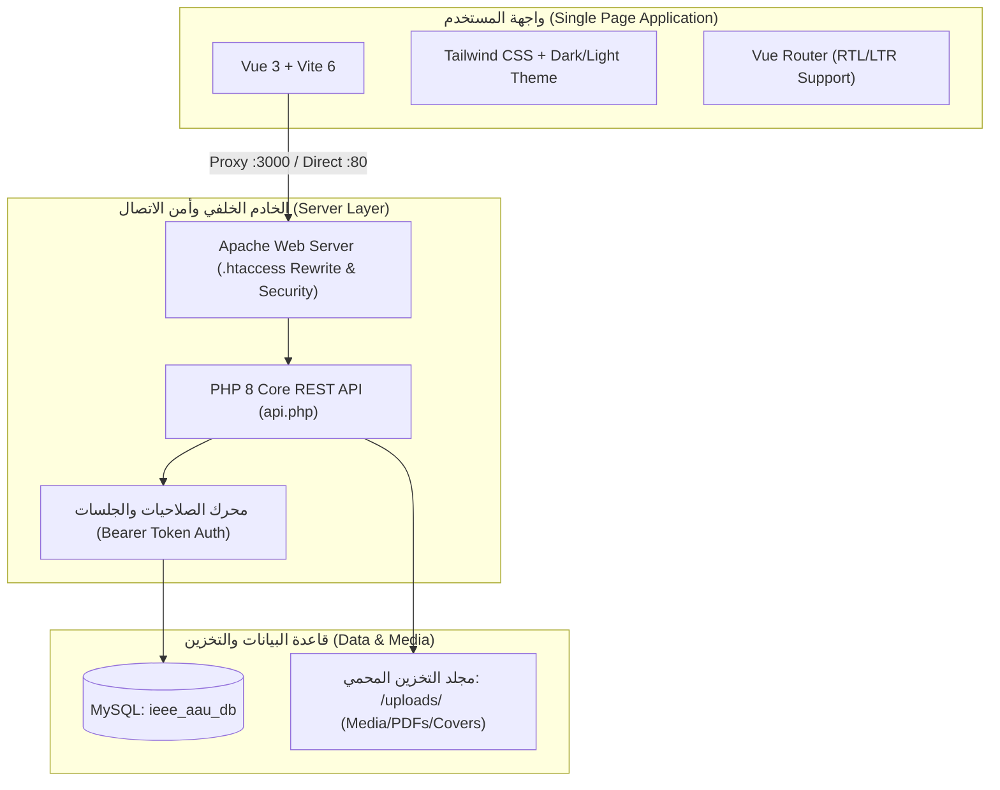
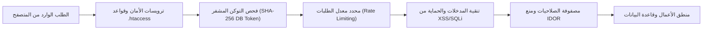

# 📘 دليل المستخدم والتشغيل الشامل لمنصة IEEE AAU Student Branch
### IEEE AAU Student Branch Platform — Comprehensive Manual User Guide

---

> [!NOTE]
> هذا الدليل مرجع تشغيلي وإداري شامل لمنصة **IEEE AAU Student Branch** (المبنية وفق وثائق المتطلبات `v0.3` و `v0.3.1` و `v0.3.3` و `v0.3.4`). يغطي الدليل كافة وظائف الموقع العام، نماذج العضوية والتطوع، لوحة التحكم والإدارة، الصلاحيات الأمنية، وطرق الصيانة والاختبار.

---

## 📑 فهرس المحتويات
1. [نظرة عامة على المنصة والبنية التقنية](#1-نظرة-عامة-على-المنصة-والبنية-التقنية)
2. [متطلبات التشغيل والتهيئة السريعة (Quick Setup)](#2-متطلبات-التشغيل-والتهيئة-السريعة)
3. [أدوار المستخدمين ومصفوفة الصلاحيات (RBAC Matrix)](#3-أدوار-المستخدمين-ومصفوفة-الصلاحيات)
4. [دليل البوابة العامة للزوار والطلاب (Public Website)](#4-دليل-البوابة-العامة-للطلاب-والزوار)
5. [دليل لوحة التحكم والإدارة (Admin Portal)](#5-دليل-لوحة-التحكم-والإدارة)
6. [إرشادات الأمان والحماية (Security Architecture)](#6-إرشادات-الأمان-والحماية)
7. [استكشاف الأخطاء وحلها (Troubleshooting & FAQ)](#7-استكشاف-الأخطاء-وحلها)
8. [حزمة الاختبارات الآلية والصيانة (Automated Tests & Maintenance)](#8-حزمة-الاختبارات-الآلية-والصيانة)

---

## 1. نظرة عامة على المنصة والبنية التقنية

تم تصميم المنصة لتكون الواجهة الرقمية الرسمية والمركز الإداري لفرع IEEE الطلابي بجامعة الزعيم الأزهري، حيث تجمع بين تجربة مستخدم سريعة وعصرية وبنية تحتية برمجية آمنة ومشددة.



### المميزات التقنية الرئيسية:
- **واجهة SPA تفاعلية:** مبنية بواسطة Vue 3 مع دعم كامل للغتين العربية (RTL) والإنجليزية (LTR)، والوضع الليلي (Dark Mode) والنهاري (Light Mode).
- **واجهة برمجة تطبيقات REST API:** كود PHP نظيف وسريع يرتبط بقاعدة بيانات MySQL ويخضع لنظام فحص الصلاحيات الدورانية (Role-Based Access Control).
- **أمن مشدد للملفات:** فحص التوقيع السحري (Magic Bytes) لكل ملف مرفوع، منع تنفيذ البرمجيات داخل مجلد المرفقات، ونظام قص ومعالجة الصور المباشر (Canvas WebP/PNG).

---

## 2. متطلبات التشغيل والتهيئة السريعة

### المتطلبات الأساسية للنظام:
- **نظام التشغيل:** Windows (مع بيئة XAMPP)، أو Linux/macOS.
- **خادم الويب:** Apache 2.4+ مع تفعيل موديل `mod_rewrite` و `mod_headers`.
- **بيئة PHP:** الإصدار 8.0 فما فوق (مع ملحقات: `pdo_mysql`, `fileinfo`, `gd`, `openssl`, `mbstring`).
- **قاعدة البيانات:** MySQL 5.7+ أو MariaDB 10.4+.
- **بيئة تشغيل العميل:** Node.js v18+ و npm v9+.

### خطوات التثبيت والتشغيل المحلي:

1. **نسخ المشروع في مجلد الويب:**
   ضع ملفات المشروع داخل مسار خادم الويب:
   `C:\xampp\htdocs\IEEE AAU SB PLATFORM`

2. **إعداد قاعدة البيانات:**
   - افتح أداة `phpMyAdmin` أو موجه أوامر MySQL.
   - أنشئ قاعدة بيانات باسم `ieee_aau_db`.
   - تأكد من تشغيل ملفات الهجرة أو استيراد الجداول الأساسية (`users`, `user_tokens`, `office_terms`, `term_positions`, `term_members`, `events`, `event_registrations`, `magazines`, `volunteer_applications`, `audit_logs`).
   - لتطبيق آخر تحديثات الجداول الأمنية، نفّذ:
     ```bash
     php database/migrate_security.php
     ```

3. **إعداد ملف البيئة (`.env`):**
   تأكد من وجود ملف `.env` في جذر المشروع يحتوي الإعدادات المناسبة:
   ```env
   DB_HOST=127.0.0.1
   DB_DATABASE=ieee_aau_db
   DB_USERNAME=root
   DB_PASSWORD=
   APP_DEBUG=true
   ```

4. **تشغيل المشروع:**
   - **الخيار الأول (الموصى به للاستخدام والإنتاج):** عبر خادم Apache مباشرة عبر الرابط:
     `http://localhost/IEEE%20AAU%20SB%20PLATFORM/`
   - **الخيار الثاني (بيئة التطوير مع التحديث الفوري):**
     ```bash
     npm run dev
     ```
     ثم افتح `http://localhost:3000` (يقوم خادم Vite تلقائياً بتحويل كافة طلبات الـ API إلى Apache عبر البروكسي الداخلي المدمج).

---

## 3. أدوار المستخدمين ومصفوفة الصلاحيات

تطبق المنصة مصفوفة صلاحيات صارمة تمنع ثغرات الوصول غير المصرح (IDOR) وتفرض الصلاحيات على مستوى الـ Back-end والـ Front-end بالتوازي:

| الدور (Role) | الرمز البرمجي | الصلاحيات والمسؤوليات |
| :--- | :--- | :--- |
| **رئيس الفرع (Chairman)** | `office_member` / `chairman` | **صلاحيات كاملة مطلقة (Super Admin)**، وهو الوحيد المخول بإنشاء وإدارة وتفعيل الدورات المكتبية ونقل الرئاسة. |
| **مسؤول الموارد البشرية (HR Officer)** | `hr` | إدارة وفرز ومراجعة وتحديث حالات طلبات المتطوعين، تصدير بيانات المتقدمين إلى Excel، وعرض المناصب. |
| **منسق البرامج (Programs Coordinator)** | `programs_coordinator` | إنشاء وإدارة وتعديل الفعاليات والورش، متابعة تسجيل الحضور والمقاعد، واستعراض تقارير الفعاليات. |
| **رئيس تحرير المجلة (Magazine Editor)** | `magazine_coordinator` | إضافة أعداد المجلة الجديدة، رفع أغلفتها وملفات الـ PDF، وتحديث وتعديل الأعداد السابقة. |
| **مسؤول الإعلام (Media Lead)** | `media_coordinator` | كتابة ونشر وإدارة الأخبار الصحفية والمقالات، وإدارة معرض الصور والسلايد شو. |
| **المستخدم المسجل (Registered Student)** | `registered_user` | التسجيل في الفعاليات، متابعة فعالياته وطلباته في صفحته الشخصية، وإلغاء التسجيل. |
| **الزائر (Visitor)** | `visitor` | تصفح الأخبار، المقالات، المجلات، صفحة الفريق، وتقديم استمارات العضوية والتطوع. |

### الحسابات الافتراضية للتجربة (Default Test Accounts):
> [!IMPORTANT]
> كلمة المرور الموحدة لجميع الحسابات التجريبية في بيئة التطوير هي: `password123`

- **رئيس الفرع:** `admin@ieee-aau.org`
- **مسؤول الموارد البشرية:** `hr@ieee-aau.org`
- **منسق البرامج والفعاليات:** `programs@ieee-aau.org`
- **رئيس تحرير المجلة:** `magazine@ieee-aau.org`
- **مسؤول الإعلام:** `media@ieee-aau.org`
- **حساب طالب تجريبي:** `student@aau.edu`

---

## 4. دليل البوابة العامة للطلاب والزوار

### 4.1 الصفحة الرئيسية (Home Page)
- **العد التنازلي التفاعلي (Live Countdown):** يقرأ تلقائياً أقرب فعالية قادمة من قاعدة البيانات بتوقيت الخرطوم (`Africa/Khartoum`). عند انتهاء الوقت أو بدء الفعالية تتبدل الحالة إلى `Live Now` أو `Stay Tuned`.
- **إضافة الفعالية للتقويم:** زر مخصص لتنزيل ملف التقويم العالمي (`.ics`) لإضافتها مباشرة إلى Google Calendar أو Outlook.
- **معرض أحدث 3 أعداد من المجلة:** يعرض أحدث 3 نسخ منشورة بأغلفتها النقية دون نصوص مشوشة على الغلاف، ومزود بزرين لكل عدد:
  - **عرض (View):** لمعاينة ملف المجلة مباشرة.
  - **تنزيل (Download):** لتحميل العدد بصيغة PDF.
- **ملخص القيادة التنفيذية:** عرض سريع للقيادة مع رابط ينقل لصفحة الفريق الكاملة.

### 4.2 صفحة فريقنا (Our Team Page)
مقسمة وفق الهيكلية التنظيمية المعتمدة لفرع IEEE AAU:
- **الصف الأول القيادي (2 بطاقات):** رئيس الفرع (Chairman 👑) ونائب الرئيس (Vice Chair ⭐) ببطاقتين متناسقتي الحجم والتصميم.
- **الصف الثاني التنفيذي (3 بطاقات):** أمين السر (Secretary)، أمين الصندوق (Treasurer)، ومسؤول الموارد البشرية (HR Officer).
- **قسم منسقي اللجان والفرق (8 بطاقات):** منسقو فرق البرامج، العلاقات العامة، المتحدثين، التقديم، الإعلام، المجلة، التصميم، والتقنية.
- **أرشيف الدورات السابقة:** قائمة منسدلة تتيح استعراض الهيئات الإدارية للدورات السابقة فور اختيار العام.

### 4.3 صفحة الفعاليات (Events Page)
- استعراض الفعاليات القادمة والسابقة مع مؤشرات الحالة (Online / In-Person / Hybrid).
- **التسجيل الذكي:** إذا كان المستخدم مسجلاً دخوله، يتم تأكيد حجزه فوراً وحجز مقعد من إجمالي المقاعد المتاحة. في حال عدم تسجيل الدخول، يتم تحويله لصفحة الدخول ثم إعادته لنفس الفعالية.

### 4.4 استمارة التطوع الديناميكية (Volunteer Application v0.3.3)
- **الأسئلة الديناميكية:** عند اختيار المتقدم لفريق معين (مثلاً: الإعلام، أو التصميم، أو البرامج) تتغير حقول الاستمارة تلقائياً لتظهر الأسئلة الخاصة بذلك الفريق فقط.
- **الحقول التخصصية لـ Media:** إمكانية تحديد المجالات الفرعية (فيديو، كتابة محتوى، تصوير فوتوغرافي، مونتاج).
- **حد الكلمات للمجلة:** حقل مقال المجلة مزود بعداد ذكي لا يتجاوز 100 كلمة كحد أقصى.
- **الحفظ كمسودة (Save as Draft):** حفظ البيانات المدخلة في المتصفح للعودة إليها لاحقاً.

### 4.5 طلب العضوية وتتبعه (Membership Wizard & Tracking)
- **معالج الانضمام (Join Wizard):** نموذج تفاعلي مكون من 5 خطوات يبدأ بالشروط والأحكام، ثم البيانات الشخصية، فالبيانات الأكاديمية، ثم شاشة المراجعة، وينتهي ببطاقة نجاح تحوي رقم الطلب (مثال: `#001`).
- **تتبع حالة الطلب (Track Application):** يتيح لأي طالب إدخال رقم طلبه أو بريده الإلكتروني لمعرفة نتيجة الفرز والمراجعة وملاحظات لجنة العضوية في أي وقت.

---

## 5. دليل لوحة التحكم والإدارة

تتيح لوحة التحكم (`/admin`) للأعضاء الإداريين إدارة الفرع بحسب صلاحياتهم:

### 5.1 إدارة الدورات المكتبية (Office Terms Management)
> [!IMPORTANT]
> هذه الصفحة متاحة **حصرياً لرئيس الفرع (Chairman)** وفق المواصفة `v0.3.4`.

- **إنشاء دورة جديدة:** تحديد اسم الدورة (مثال: `2026 – 2027`)، تاريخ البدء، وتاريخ الانتهاء.
- **تسكين المناصب:** تعيين الأعضاء في المناصب القيادية الخمسة ومنسقي الفرق الثمانية، مع رفع صورهم وتحديد نبذاتهم التعريفية وروابط LinkedIn وبريدهم الرسمي.
- **تفعيل الدورة:** زر واحد لتفعيل الدورة الجديدة لتظهر تلقائياً كدورة رسمية في صفحة Our Team، مع تحويل الدورة الحالية تلقائياً إلى الأرشيف.

### 5.2 إدارة المجلة (Magazine Management)
- **إضافة عدد جديد:**
  - كتابة عنوان العدد ورقم النسخة (مثال: `Vol. 13 Issue 2`).
  - اختيار سنة وشهر النشر.
  - **رفع صورة الغلاف:** داعم لملفات JPG، PNG، WebP، وتلقائياً يتم حفظه في مجلد `uploads/covers/`.
  - **رفع ملف المجلة:** رفع ملف الـ PDF كاملاً ويخضع للفحص الأمني في `uploads/magazines/`.
- **التعديل والتحديث:** إمكانية تعديل روابط أو أغلفتها أو تفاصيل أي عدد سابق في أي وقت.

### 5.3 إدارة الإعلام والأخبار (Media Lead Management)
- **إضافة خبر / مقال:** إدخال العنوان، التصنيف، الكاتب، المحتوى، وحالة النشر (مسودة / منشور).
- **رفع الصور:** يدعم أداة القص المباشرة عبر Canvas لتوليد صور خفيفة وسريعة التحميل بصيغة WebP.
- **السلايد شو:** تحديد الأخبار المميزة لتظهر في السلايد شو المتحرك في بداية صفحة الأخبار.

### 5.4 إدارة طلبات المتطوعين (Volunteer Applications)
- **استعراض شامل لجميع البيانات:** تعرض شاشة المعاينة كافة البيانات التي سجلها المتقدم (الاسم الرباعي، الجامعة، الكلية، الفريق، إجابات الأسئلة التخصصية، روابط الأعمال السابقة Portfolio).
- **تحديث الحالة الإدارية:** (Pending ⏳ -> Interviewed 📞 -> Accepted ✅ / Rejected ❌).
- **التصدير إلى Excel (.xlsx):** تنزيل شيت Excel منظم يحوي جميع إجابات المتطوعين مع تطبيق الحماية الصارمة ضد ثغرات Formula Injection (`=`, `+`, `-`, `@`).

---

## 6. إرشادات الأمان والحماية

تم تطبيق تدقيق أمني شامل (Security Hardening) على كافة طبقات التطبيق:



1. **المصادقة المشفرة (Cryptographic Bearer Tokens):**
   - استبدال الرموز السابقة برمز سداسي عشوائي مشفر بطول 64 خانة (`bin2hex(random_bytes(32))`) ومخزن كـ `SHA-256` في جدول `user_tokens` مع انتهاء الصلاحية بعد 7 أيام.
   - ترحيل تلقائي هادئ للجلسات المفتوحة مسبقاً لمنع انقطاع خدمة أي مستخدم حالي.
2. **منع هجمات القوة الغاشمة (Rate Limiting):**
   - حد أقصى 5 محاولات لتسجيل الدخول لكل 15 دقيقة، وإغلاق تلقائي عند التجاوز.
3. **أمان رفع الملفات (File Upload Hardening):**
   - فحص الامتداد ونوع الـ MIME والتوقيع الداخلي (`getimagesize` للصور و `%PDF` للمجلات).
   - حظر كامل لتنفيذ أي سكربت PHP أو CGI داخل مجلد `uploads/` عبر ملف `.htaccess` مخصص.
4. **حماية التصدير (Excel Formula Injection - CWE-1236):**
   - تنقية كافة الحقول النصية التي تبدأ بعلامات حسابية (`=`, `+`, `-`, `@`) ببادئة الاقتباس الأحادي لمنع تنفيذ الأوامر الخبيثة في برامج الجداول.
5. **ترويسات الأمان (Security Headers):**
   - `X-Content-Type-Options: nosniff`
   - `X-Frame-Options: SAMEORIGIN`
   - `Content-Security-Policy` متوازنة تدعم الـ Blobs ووسائط العرض بأمان.

---

## 7. استكشاف الأخطاء وحلها (Troubleshooting & FAQ)

### س: يظهر خطأ "Unexpected token '<', '<?php ...' is not valid JSON" في لوحة الأخطاء؟
- **السبب:** فتح الموقع عبر خادم التطوير Vite على المنفذ 3000 دون تفعيل البروكسي الداخلي.
- **الحل:** تم ضبط البروكسي مسبقاً في ملف `vite.config.js`، كل ما عليك هو التأكد من تشغيل خادم Apache من لوحة XAMPP وعمل تحديث للمتصفح (`F5`).

### س: تظهر رسالة "Network error during upload" عند محاولة رفع صورة أو مجلة؟
- **السبب:** إما انتهاء صلاحية الجلسة، أو إزالة Apache لترويسة التوثيق، أو رفع ملف بصيغة غير مدعومة.
- **الحل:** 
  1. تم تضمين قواعد Rewrite في `.htaccess` لحفظ الترويسات.
  2. تأكد من أن الملف بصيغة صورة (`PNG`, `JPG`, `WebP`) أو ملف مستند (`PDF`).
  3. إن لزم الأمر، قم بتسجيل الخروج والدخول مجدداً لتجديد رمز التوكن.

### س: اختفاء بطاقات أعضاء المكتب في لوحة التحكم؟
- **الحل:** تم تعديل استعلامات المناصب لتعمل عبر `LEFT JOIN`، مما يضمن عرض كافة المناصب الـ 13 حتى لو لم يُسكن بها عضو بعد، مع تفعيل القائمة الافتراضية التلقائية.

---

## 8. حزمة الاختبارات الآلية والصيانة

يحتوي مجلد `tests/` على حزمة اختبارات برمجية وأمنية يمكن تشغيلها في أي وقت للتأكد من سلامة النظام بعد أي تعديل:

### تشغيل فحص الأمان والصلاحيات الشامل:
```bash
php tests/SecurityAndRbacTest.php
```
*يتحقق من 27 معياراً أمنياً تشمل: منع تجاوز المصادقة، الترويسات، صلاحيات كل دور على كل مسار، تنقية الإكسل، وفحص صحة المدخلات.*

### تشغيل اختبار دورة العمل الكاملة (Full E2E Flow):
```bash
php tests/test_full_flow.php
```
*يختبر تسجيل الدخول، استرجاع أعضاء الدورة، إنشاء فعالية جديدة، وإضافة عدد جديد للمجلة بنجاح.*

### إعادة بناء حزمة الواجهة الأمامية:
```bash
npm run build
```
*يقوم بضغط وترقية ملفات الـ Vue والـ CSS داخل مجلد `dist/` المخصص للإنتاج.*

---

**تم إعداد هذا الدليل وتدقيقه لفرع IEEE الطلابي بجامعة الزعيم الأزهري (IEEE AAU Student Branch).**
`Git Branch: main` | `Version: 1.0.0 (Production Ready)`
